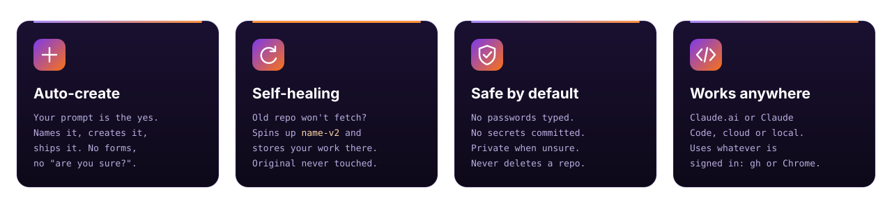
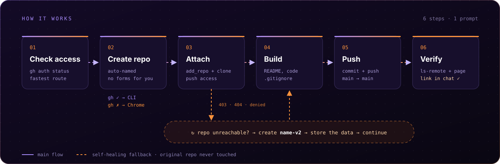

<p align="center">
  
</p>

<p align="center">
  <a href="skills/repo-launcher/SKILL.md"></a>
  <a href="LICENSE"></a>
  
  
</p>

<p align="center">
  <b>One prompt. New repo. Code shipped.</b><br>
  <sub>Claude creates the repo, pushes your code, and rescues your work into a new repo if the old one breaks.</sub>
</p>

<p align="center">
  <a href="#-install">Install</a> ·
  <a href="#-how-it-works">How it works</a> ·
  <a href="#-self-healing-fallback">Fallback</a> ·
  <a href="#-safety">Safety</a> ·
  <a href="skills/repo-launcher/SKILL.md">Read the skill</a>
</p>

<br>

## ◆ The problem

Inside a Claude session, GitHub access usually works only with repos that **already exist**. Claude can push to them, but it can't **create** one, and the `gh` CLI often isn't signed in. Ask *"make a repo and publish my code"* and it stalls at step one.

When a repo you *do* have breaks (permissions changed, renamed, archived, deleted), the push fails and your work is left sitting in a temporary workspace.

**repo-launcher fixes both problems.**

<br>

## ◆ What it does

<p align="center">
  
</p>

<br>

## ◆ How it works

<p align="center">
  
</p>

| Step | What Claude does | Tooling |
|:---:|---|---|
| `01` | Finds the fastest signed-in route | `gh auth status` |
| `02` | Creates the repo: auto-named, matching visibility | `gh repo create` **or** Chrome → `github.com/new` |
| `03` | Attaches the repo to the session and clones it | `add_repo` · `git clone --depth 1` |
| `04` | Writes README, code, `.gitignore`, and never secrets | file tools |
| `05` | Commits and pushes | `git push -u origin main` |
| `06` | Verifies on GitHub and sends you the link | `git ls-remote` · repo page |

<br>

## ◆ Self-healing fallback

<p align="center">
  
</p>

If the repo you asked for **can't be fetched or pushed to**, Claude doesn't stop or lose your work. It creates `name-v2` and stores everything there.

| Triggers a rescue ↻ | Fixed in place instead |
|---|---|
| `add_repo` refused (not authorized, app not installed) | `429`: wait 5 s, retry once |
| Clone or fetch: `403`, `404`, `could not read Username` | `413`: shallow fetch, rebase, push |
| Push denied, repo archived | Merge conflicts or failing hooks |
| Repo deleted or renamed | Protected branch: opens a PR instead |

**Rescue rules:** private unless the original was public · git history kept when possible · a README note links back to the original · **the original is never deleted, renamed or force-pushed.**

<br>

## ◆ Auto mode vs confirm mode

<table>
<tr>
<th width="50%">⚡ Auto <sub>(default)</sub></th>
<th width="50%">👁 Confirm</th>
</tr>
<tr>
<td>

Your request **is** the approval.

```text
make a repo for my portfolio and push it
publish this project, you pick the name
```

Claude names it, creates it, ships it, then reports the link.

</td>
<td>

Claude fills everything in, then waits for your yes.

```text
draft a repo for this, show me first
set it up but don't create yet
```

Use this for org repos or anything you want to review.

</td>
</tr>
</table>

Auto mode still stops when content looks **sensitive and would go public**, when the owner is an **organization**, when a step would **delete or overwrite** something, or when GitHub needs **your sign-in**.

<br>

## ◆ Install

<details open>
<summary><b>Claude.ai</b> (web or desktop app)</summary>

1. Download the ready-made ZIP: [`dist/repo-launcher.zip`](dist/repo-launcher.zip) (click **Download raw file**).
2. In Claude, open **Customize → Skills**.
3. Click **+** → **Create skill** → **Upload a skill**, and pick the ZIP.
4. Make sure the skill is toggled **on**.

> Custom skills need a **Pro, Max, Ultra, Team or Enterprise** plan with **code execution** turned on.
> Zipping it yourself? The ZIP must contain the `repo-launcher/` **folder**, not loose files.
> `./scripts/package.sh` builds it correctly.

</details>

<details>
<summary><b>Claude Code</b> (terminal, all projects)</summary>

```bash
git clone https://github.com/MAYANKKONTEY/claude-repo-launcher
mkdir -p ~/.claude/skills
cp -r claude-repo-launcher/skills/repo-launcher ~/.claude/skills/
```

Restart Claude Code. The skill loads automatically.

</details>

<details>
<summary><b>One project only</b></summary>

```bash
mkdir -p .claude/skills
cp -r path/to/claude-repo-launcher/skills/repo-launcher .claude/skills/
```

</details>

**Requirements:** a GitHub account, plus **one** of the following:
`gh` signed in (`gh auth login`) **or** the Claude in Chrome extension with GitHub signed in.
If you have neither, Claude asks you to create the empty repo and handles the rest.

<br>

## ◆ Safety

| | |
|---|---|
| 🔑 | Never types passwords, tokens or 2FA codes. You sign in yourself. |
| 🧹 | Never commits `.env`, keys or credentials. If it finds one, it leaves it out and tells you. |
| 🔒 | Makes the repo **private** when the content looks sensitive or it's unsure. |
| 🛡 | Never deletes, renames or force-pushes an existing repo. |
| 👤 | Creates repos under **your** account only, unless you name an org. |

<br>

## ◆ Project structure

```text
claude-repo-launcher/
├── skills/
│   └── repo-launcher/
│       └── SKILL.md        # the workflow Claude follows
├── dist/
│   └── repo-launcher.zip   # upload-ready for Claude.ai
├── scripts/
│   └── package.sh          # rebuilds the ZIP from skills/
├── assets/                 # README artwork (hand-written SVG)
│   ├── banner.svg
│   ├── features.svg
│   ├── workflow.svg
│   ├── terminal.svg
│   └── footer.svg
├── LICENSE                 # MIT
└── README.md
```

<br>

## ◆ Changelog

**v1.2: bug fixes** (each one reproduced in a sandbox, then fixed)
- 🐛 **Rescue push failed** with `shallow update not allowed`. The fallback now pulls the full history first, and pushes a snapshot if it can't.
- 🐛 **Push to `main` failed** when git started the branch as `master`. The branch is now set to `main` before pushing.
- 🐛 **`origin/main` never updated** after cloning an empty repo, because no fetch refspec was set. The fetch refspec is now set right after cloning.
- 🐛 **Visibility couldn't be set** with `form_input`, because it's a dropdown button. The skill now clicks the option instead.
- 🐛 **Install steps pointed to an old menu.** They now use **Customize → Skills**, and an upload-ready ZIP is included.
- Rescued repos are attached to the session before pushing, and the skill runs a `git status` check for secrets before every commit.

**v1.1**
- **Auto mode:** creates the repo with no confirmation step when you ask for one.
- **Self-healing fallback:** if an existing repo is unreachable, Claude creates `name-v2` and stores the work there.
- Redesigned README with original artwork.

**v1.0**
- First release. This repo was created by the skill itself.
- Lessons from that run: use `form_input` instead of typing, because typing dropped a letter in the description. Start from an empty repo for a clean first push. Treat `push negotiation failed` as a warning only.

<br>

## ◆ Roadmap

- [x] Auto-create mode
- [x] Self-healing fallback into a new repo
- [x] Set description and topics after creation
- [ ] `.gitignore` templates for Python, Node and Swift
- [ ] Turn on GitHub Pages automatically for static sites
- [ ] Log each launch to [Build-in-public-365-day](https://github.com/MAYANKKONTEY/Build-in-public-365-day)

<br>

<p align="center">
  
  <br>
  <a href="https://www.linkedin.com/in/mayank-kontey-312770370/">LinkedIn</a> ·
  <a href="https://github.com/MAYANKKONTEY">GitHub</a>
</p>
